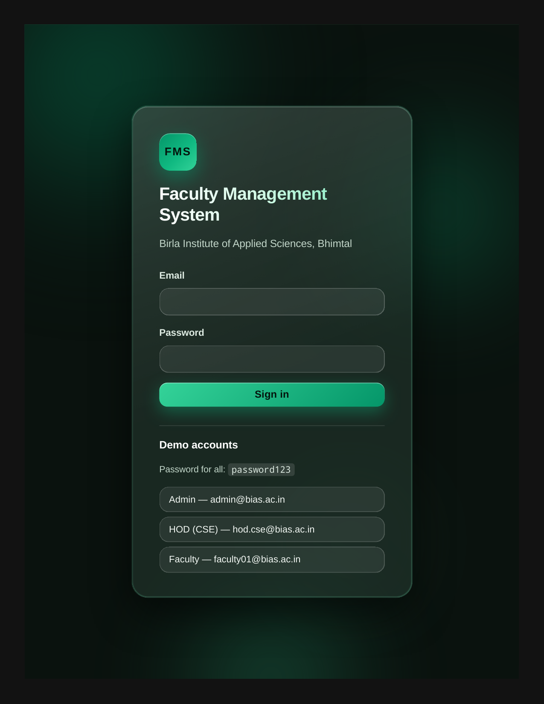
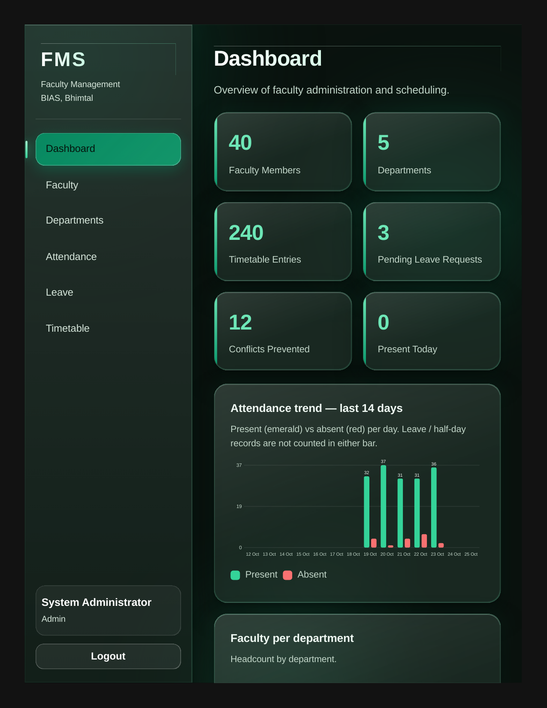
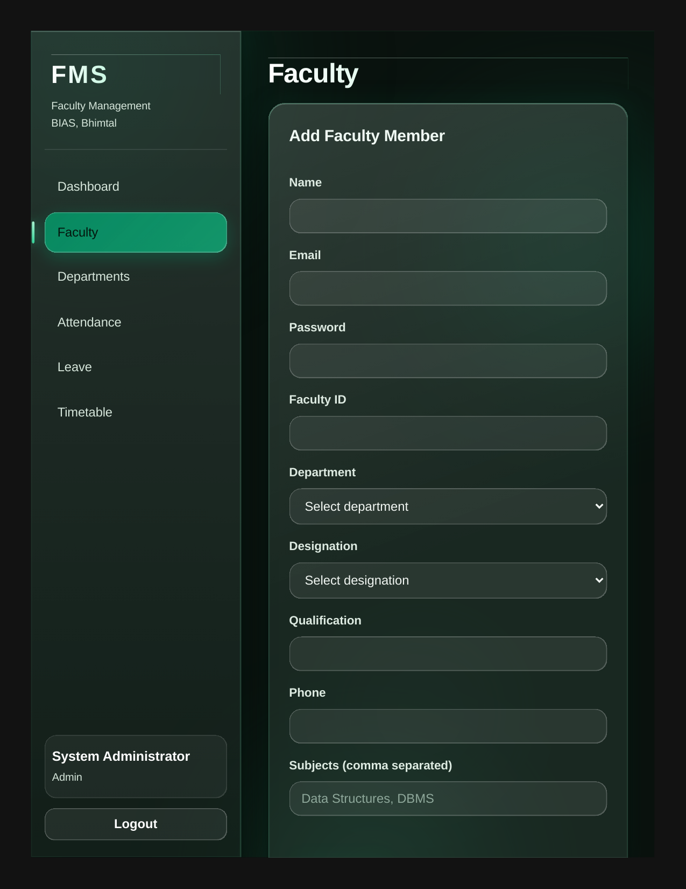
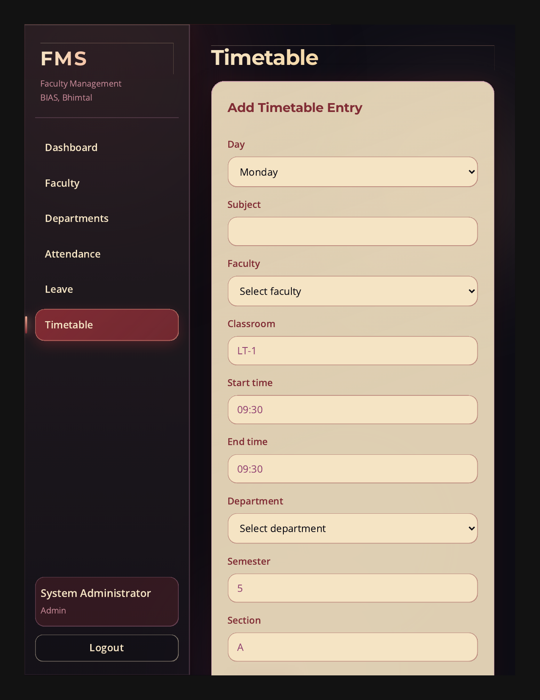

# Faculty Management System with Automated Timetable Conflict Detection


A MERN-stack web application for managing faculty, departments, attendance, leave requests, and timetables at an academic institution — with **automated, rule-based timetable conflict detection** as its key feature. When a new timetable entry would double-book a faculty member or a classroom, the entry is blocked before it is saved, and the blocked attempt is logged and counted on the dashboard.

See the [Screenshots](#screenshots) section below for the green liquid-glass theme in action.

## Features

- **Faculty management** — Create, view, update, and delete faculty profiles, organised by department. Faculty accounts see only their own profile in the list; HODs see only their own department.
- **Department management** — Manage the institution's departments (admin only for create, update, and delete).
- **Attendance tracking** — Record and view attendance rows for faculty.
- **Leave workflow** — Faculty apply for leave; admins and HODs review (approve/reject) requests.
- **Automated timetable conflict detection** — The headline feature (see below). Conflicting entries are rejected with a clear explanation instead of silently overwriting a schedule.
- **Conflict log** — Every blocked timetable attempt is recorded and viewable by admins and HODs.
- **Dashboard summary** — At-a-glance counts: faculty, departments, timetable entries, pending leave requests, conflicts prevented, and today's attendance.
- **Role-based access control (RBAC)** — Three roles (`admin`, `hod`, `faculty`), enforced server-side and reflected in the UI, which gates forms by role.
- **JWT authentication** — Login returns a JSON Web Token, sent as a `Bearer` token on subsequent requests. Passwords are hashed with bcryptjs.
- **Premium liquid-glass UI** — Frosted-glass panels, an animated plasma/aurora gradient background, gradient headings, and glowing buttons.
  - *Honest note: the visual polish was verified by code review and a successful production build, not by a live-browser screenshot pass.*

## Screenshots

Green liquid-glass theme:


*Login — green liquid-glass theme*


*Dashboard — green liquid-glass theme*


*Faculty — green liquid-glass theme*


*Timetable — green liquid-glass theme*

## How conflict detection works

The detector is rule-based and lives in `server/src/utils/conflict.js`, applied on both timetable creation (`POST /api/timetable`) and update (`PUT /api/timetable/:id`).

A new entry is **blocked** when, on the **same day**, its time interval **overlaps** an existing entry **and** they share the **same faculty member OR the same classroom**.

- Overlap uses **half-open intervals** `[start, end)` — so an entry ending at 10:00 does not conflict with one starting at 10:00.
- A blocked entry returns **HTTP 409** with a `conflicts` array of human-readable detail strings. Example detail from a real test:
  > `faculty FAC001 is already teaching and classroom SPOT-1 is already booked on Saturday 09:00-10:00 (Leader Spotcheck)`
- The blocked entry is **NOT saved**.
- The blocked attempt is **logged** (see `GET /api/timetable/conflicts-log`) and **counted on the dashboard** as `conflictsPrevented`.
- An entry whose `endTime` is not after its `startTime` is rejected with HTTP 400.

## Tech stack

| Layer | Technology |
|---|---|
| Database | MongoDB + Mongoose |
| Backend | Express.js on Node.js |
| Frontend | React (Vite) + react-router-dom |
| Authentication | JSON Web Tokens (JWT) |
| Password hashing | bcryptjs |
| Dev / fallback database | mongodb-memory-server (in-memory MongoDB, used automatically when no `MONGODB_URI` is set) |

## System architecture

```
React SPA (Vite) ──► Express API ──► Mongoose ──► MongoDB
  client/src          server/src        models     hosted MongoDB
  pages, api.js       routes, middleware  (Faculty,  (via MONGODB_URI)
                      middleware/auth.js  Timetable, or in-memory
                      utils/conflict.js   Department, MongoDB fallback)
                                          User, Leave,
                                          Attendance,
                                          ConflictLog)
```

- **Client → API:** The Vite dev server proxies `/api` to `http://localhost:5000`. For deployment, the API base is configurable via the `VITE_API_URL` environment variable, which falls back to the `/api` proxy when unset.
- **API → database:** Express routes use Mongoose models. Timetable writes pass through the conflict detector before anything is saved.
- **Authentication:** `POST /api/auth/login` issues a JWT. The `protect` middleware verifies the token on protected routes, and `requireRole` middleware enforces roles server-side (for example, only `admin` can register users or delete faculty; only `admin`/`hod` can create timetable entries). The UI additionally gates forms by role, but the server is the authority.
- **Role scoping:** HODs are scoped to their own department in faculty and timetable listings; faculty users see only their own profile.

## Getting started

### Prerequisites

- Node.js and npm
- A MongoDB instance is **optional**: if none is configured, the server starts an in-memory MongoDB automatically (see below).

### Run the backend

```bash
cd server
npm install
npm start
```

The server runs on port `5000` by default (`PORT` in `server/.env` overrides it).

**Database behaviour:**

- If `MONGODB_URI` is set in `server/.env`, the server connects to that MongoDB (for example, a hosted MongoDB such as Atlas, supplied via this option).
- If `MONGODB_URI` is **not** set, the server starts an in-memory MongoDB automatically and **auto-seeds demo data** on first start. In this mode, data **resets on restart**.

To configure the server, copy the example file and edit it (never commit a real `.env`):

```bash
cp server/.env.example server/.env
```

Useful server scripts (see `server/package.json`):

```bash
npm run dev    # start with file watching (node --watch)
npm run seed   # run the seed script directly
```

### Run the frontend

```bash
cd client
npm install
npm run dev
```

This starts the Vite dev server (port `5173`), with `/api` proxied to `http://localhost:5000`. Open the printed local URL and log in with a demo account below.

For a production build:

```bash
cd client
npm run build
```

For deployment, set `VITE_API_URL` to the hosted backend's API base URL (see `client/.env.example`); when left empty, the `/api` proxy is used.

## Demo data (auto-seeded on first server start)

- **5 departments:** CSE, ECE, EE, ME, CE
- **1 admin** account
- **5 HODs** (one per department)
- **40 fictional faculty profiles**
- **200 attendance rows**
- **240 timetable entries**
- **8 sample leave requests**

## Demo accounts

The password for **all** demo accounts is:

```
password123
```

| Email | Role |
|---|---|
| `admin@bias.ac.in` | admin |
| `hod.cse@bias.ac.in` | HOD, CSE |
| `faculty01@bias.ac.in` | faculty |

## API endpoints

Base URL (development): `http://localhost:5000/api`. All endpoints except `GET /api/health` and `POST /api/auth/login` require a JWT `Authorization: Bearer <token>` header.

| Method | Endpoint | Who can use it | Description |
|---|---|---|---|
| GET | `/api/health` | Public | Health check, returns `{ status: "ok" }` |
| POST | `/api/auth/login` | Public | Log in, receive a JWT |
| POST | `/api/auth/register` | Admin | Register a new user |
| GET | `/api/auth/me` | Authenticated | Current user profile |
| GET | `/api/departments` | Authenticated | List departments |
| POST | `/api/departments` | Admin | Create a department |
| PUT | `/api/departments/:id` | Admin | Update a department |
| DELETE | `/api/departments/:id` | Admin | Delete a department |
| GET | `/api/faculty` | Authenticated | List faculty (faculty role sees only self; HOD sees own department) |
| GET | `/api/faculty/me` | Authenticated | Current user's faculty profile |
| POST | `/api/faculty` | Admin | Create a faculty member (account + profile) |
| PUT | `/api/faculty/:id` | Admin / own-department HOD / self (limited fields for self) | Update a faculty profile |
| DELETE | `/api/faculty/:id` | Admin | Delete a faculty member |
| GET | `/api/attendance` | Authenticated | List attendance rows |
| POST | `/api/attendance` | Admin, HOD | Record attendance |
| GET | `/api/leaves` | Authenticated | List leave requests |
| POST | `/api/leaves` | Authenticated | Apply for leave |
| PUT | `/api/leaves/:id/review` | Admin, HOD | Approve or reject a leave request |
| GET | `/api/timetable` | Authenticated | List timetable entries (filterable by day, department, faculty; HOD scoped to own department) |
| GET | `/api/timetable/conflicts-log` | Admin, HOD | Recently blocked timetable attempts |
| POST | `/api/timetable` | Admin, HOD | Create a timetable entry (conflict-checked; 201 on success, 409 if blocked) |
| PUT | `/api/timetable/:id` | Admin, HOD | Update a timetable entry (conflict-checked) |
| DELETE | `/api/timetable/:id` | Admin, HOD | Delete a timetable entry |
| GET | `/api/dashboard/summary` | Authenticated | Dashboard counts (`facultyCount`, `deptCount`, `timetableCount`, `pendingLeaves`, `conflictsPrevented`, today's attendance) |

## Folder structure

```
faculty-management-system/
├── client/
│   ├── index.html
│   ├── vite.config.js          # Vite dev server (port 5173, /api proxy to localhost:5000)
│   ├── .env.example            # VITE_API_URL (empty = use the /api proxy)
│   ├── package.json            # react, react-dom, react-router-dom; vite build/dev/preview
│   └── src/
│       ├── main.jsx
│       ├── App.jsx             # Routes: /, /faculty, /departments, /attendance, /leaves, /timetable, /login
│       ├── App.css             # Liquid-glass styling
│       ├── api.js              # API client (VITE_API_URL or /api fallback, Bearer token handling)
│       ├── components/         # (directory present; no component files yet)
│       └── pages/
│           ├── Dashboard.jsx
│           ├── Faculty.jsx
│           ├── Departments.jsx
│           ├── Attendance.jsx
│           ├── Leave.jsx
│           ├── Timetable.jsx
│           └── Login.jsx
└── server/
    ├── package.json            # express, mongoose, jsonwebtoken, bcryptjs, cors, dotenv; mongodb-memory-server (dev)
    ├── .env.example            # MONGODB_URI, PORT, JWT_SECRET, JWT_EXPIRES_IN
    └── src/
        ├── index.js            # Express app, /api route mounting, health endpoint
        ├── seed.js             # Demo data seeding
        ├── config/
        │   └── db.js           # MongoDB connection, incl. in-memory fallback
        ├── models/
        │   ├── User.js
        │   ├── Faculty.js
        │   ├── Department.js
        │   ├── Timetable.js
        │   ├── Attendance.js
        │   ├── Leave.js
        │   └── ConflictLog.js
        ├── middleware/
        │   └── auth.js         # protect (JWT) and requireRole (RBAC)
        ├── routes/
        │   ├── auth.js
        │   ├── departments.js
        │   ├── faculty.js
        │   ├── attendance.js
        │   ├── leave.js
        │   ├── timetable.js    # Conflict-checked create/update, conflicts-log
        │   └── dashboard.js
        └── utils/
            └── conflict.js     # Half-open interval overlap, findConflicts, describeConflict, logBlockedAttempt
```

> Note: `node_modules/`, `client/dist/`, and `.env` files are not part of the source tree — they are generated or local-only and are excluded by `.gitignore`.

## Testing

**Verified live** against the production site (https://synopsis-tan.vercel.app/) and its hosted MongoDB Atlas database — not an in-memory database.

Verified results:

- Health endpoint returns **200**
- Admin login works
- **40 faculty** listed
- A non-conflicting timetable entry returns **201**
- An overlapping timetable entry returns **409** and is confirmed **not saved**
- Dashboard summary returns `facultyCount=40`, `deptCount=5`, `timetableCount=240`, `pendingLeaves=3`
- The `faculty` role correctly receives **403** on admin endpoints
- Leave apply → admin approve workflow verified
- Frontend production build (`vite build`) passes

### Testing metrics (measured live, 2026-10-25)

| Test | Attempts | Correct | Rate |
|---|---|---|---|
| Clean timetable saves (should save) | 10 | 10 saved (201) | False positives: 0/10 (0%) |
| Overlapping saves, same faculty or classroom (should block) | 10 | 10 blocked (409) | False negatives: 0/10 (0%) |
| Mean/median response | — | Clean save 1,667 / 1,615 ms; blocked save 1,000 / 1,002 ms | — |

- Cleanup verified 2026-10-25: all test entries deleted, timetable back to 240 entries, zero test entries remaining, dashboard 40 faculty / 5 departments / 240 entries.
- Note: the first login during the test took 71 s, a Vercel serverless cold-start artifact (the same call later took ~1.2 s) — it is not typical login latency and is not headlined above. Conflicts-prevented rose 2 → 12 during the test because each blocked attempt leaves an audit-log row, which is by design.

## Team

**Team FUSION** — Birla Institute of Applied Sciences (BIAS), Bhimtal

- **Project guide:** Mr. Prashant Mishra
- **Programme:** B.Tech, Computer Science and Engineering (mini project)
- **Session:** 2026–2027
